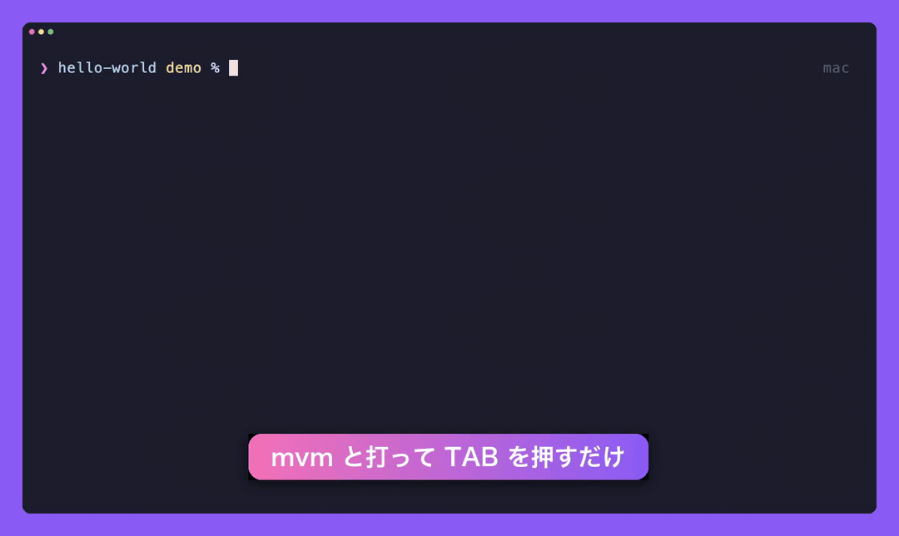
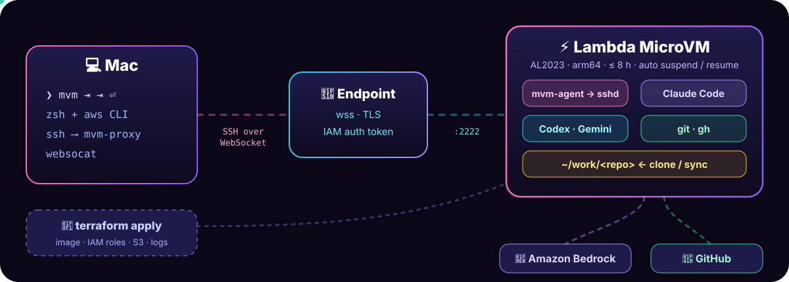

<div align="center">



<p>


</p>

### ⌨️ `mvm ⇥` → 🚀 MicroVM → 🧑‍💻 Claude Code → 🧹 `mvm rm ⇥`



<sub>🎬 <a href="docs/assets/demo.mp4">MP4</a> · 💬 字幕 <a href="docs/assets/demo.ja.vtt">ja.vtt</a> · <a href="docs/assets/demo.en.vtt">en.vtt</a> · <a href="docs/assets/demo.ja.srt">ja.srt</a> · 🎥 <a href="demo/demo.tape">recorded with vhs</a></sub>

</div>

<br>

## ⚡ Quick start

```bash
brew install awscli jq websocat                         # 🧰 手元はこれだけ
(cd terraform && terraform init && terraform apply)     # 🧱 イメージ・IAM・S3 (~10 min)
echo "source $PWD/shell/mvm.zsh" >> ~/.zshrc && exec zsh
mvm ⇥                                                   # 🎉
```

<br>

## ⌨️ TAB だけ



<table>
<tr>
<td align="center" width="25%">🎨<br><b>状態で色分け</b><br><sub>RUNNING 🟢 · SUSPENDED 🟡</sub></td>
<td align="center" width="25%">🔎<br><b>名前で選ぶ</b><br><sub><code>mvm hello⇥</code> → ID</sub></td>
<td align="center" width="25%">🔮<br><b>Enter の予告</b><br><sub>完成した行で ⇥</sub></td>
<td align="center" width="25%">⚡<br><b>先読み</b><br><sub><code>mvm␣</code> で一覧を取得</sub></td>
</tr>
</table>

<br>

## 🧩 しくみ



<br>

## 🎁 VM の中

<table>
<tr>
<td>🤖</td><td><b>Agents</b></td><td><code>claude</code> · <code>codex</code> · <code>gemini</code> <sub>— Bedrock, API キー不要</sub></td>
</tr>
<tr>
<td>🐙</td><td><b>GitHub</b></td><td><code>git</code> · <code>gh</code> <sub>— トークンはメモリだけ</sub></td>
</tr>
<tr>
<td>☁️</td><td><b>Cloud</b></td><td><code>aws</code> · <code>cdk</code> · <code>terraform</code> · <code>kubectl</code> · <code>helm</code></td>
</tr>
<tr>
<td>🔎</td><td><b>CLI</b></td><td><code>rg</code> · <code>fd</code> · <code>fzf</code> · <code>bat</code> · <code>jq</code> · <code>yq</code> · <code>delta</code> · <code>lazygit</code> · <code>nvim</code> · <code>tmux</code></td>
</tr>
<tr>
<td>🧰</td><td><b>On demand</b></td><td><code>mvm-install go rust python java ruby node-pm build</code></td>
</tr>
</table>

<br>

## 🤖 Coding Agent から

```bash
ln -s "$PWD/skills/mvm" ~/.claude/skills/mvm            # 🧠 skill
```

```bash
ID=$(bin/mvm up --no-login)                             # 🚀 id だけを stdout に
bin/mvm exec $ID --sync -- 'npm ci && npm test'         # 🧪 手元の未コミットの変更ごとテスト
bin/mvm port $ID 3000                                   # 🌐 127.0.0.1:3000
bin/mvm exec $ID -- 'claude -p "fix the failing test"'  # 🤖 VM の中の Claude
```

<br>

## 🔒 Safe by default

<table>
<tr>
<td align="center">🔐<br><sub>入口は IAM トークン<br>＋ SSH 鍵</sub></td>
<td align="center">🧠<br><sub>GitHub トークンは<br>ディスクに書かない</sub></td>
<td align="center">🛡️<br><sub><code>/run</code> は 1 回だけ<br>鍵の差し替え不可</sub></td>
<td align="center">🧹<br><sub><code>rm</code> は必ず確認<br><code>-y</code> は補完しない</sub></td>
<td align="center">🙈<br><sub><code>MVM_MASK_ACCOUNT=1</code><br>録画用</sub></td>
</tr>
</table>

<br>

<details>
<summary>📖 <b>もっと詳しく</b></summary>

<br>

[docs/GUIDE.md](docs/GUIDE.md) にコマンド、トークンの扱い、VM の中の権限、接続の仕組み、テストの回し方をまとめています。

</details>

<div align="center">
<br>
<sub>MIT © riita10069</sub>
</div>
